# Exercise 1 - Run the Starting Application on Your Device

## Estimated time

:clock4: 15 minutes

## Objective

In this exercise, you will run a starting mobile development kit (MDK) application on your device.

| Exercise Number | Title |
| --- | --- |
| [Exercise 1.1](#exercise-11---set-up-and-open-the-mdk-project) | Set Up and Open the MDK Project |
| [Exercise 1.2](#exercise-12---provide-your-assigned-service-worker-id-to-filter-related-incidents) | Provide Your Assigned Service Worker ID to Filter Related Incidents |
| [Exercise 1.3](#exercise-13---deploy-the-application) | Deploy the Application |
| [Exercise 1.4](#exercise-14---display-the-qr-code-for-onboarding-the-mobile-app) | Display the QR Code for Onboarding the Mobile App |
| [Exercise 1.5](#exercise-15---run-the-app) | Run the App |

## Requirement

Before beginning the session exercises, please ensure that you have installed the **SAP Mobile Services Client** app from the public store. You can expedite the installation process by using the provided QR code.

| Apps | Android | iOS |
| :---: | :---: | :---: |
| SAP Mobile Services Client |  |  |

### Exercise 1.1 - Set Up and Open the MDK Project

Everything you need for this workshop is prepared by a single setup script that ships in this instructions repository (already prepared on your machine). It clones the MDK project you will work in — which already includes the in-workshop **Cline** coach — configures the Cline AI assistant (SAP AI Core + MDK tools), and opens the project in VS Code.

> If you do not see an `AD265` folder on your Desktop, [download the AD265 setup files](https://github.com/sandeep-tds/ad265-workshop-setup/releases/tag/v1.1.2) and extract the ZIP. Open the extracted `ad265-workshop-setup-1.1.2` folder, then move the `AD265` folder inside it to your Desktop.

1. Save any open work first — the script restarts VS Code. In **File Explorer**, open the `AD265` folder on your Desktop and **double-click** `setup-ad265.bat`.

    > Run it from File Explorer (double-click), **not** from the VS Code integrated terminal — the script closes and reopens VS Code, which would kill its own terminal. Administrator rights are **not** required.

    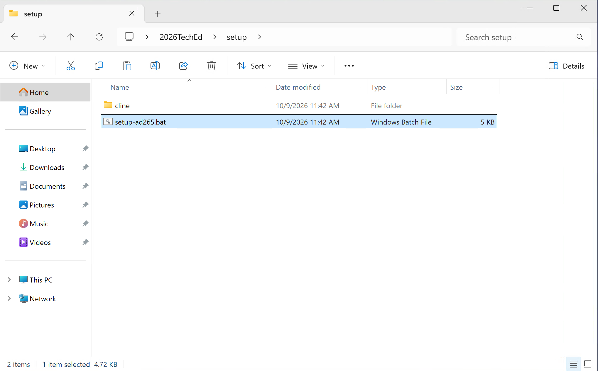

2. A console window shows the progress: it clones **MDKApp** (which ships with the coach rules) to your Desktop and installs the Cline configuration. When it finishes, VS Code opens automatically on the `MDKApp` project — no further action is needed while it runs.

3. If VS Code asks whether you trust the authors of the files in this folder, choose **Yes, I trust the authors** so the MDK editor and Cline work.

4. You will see the MDK project in the VS Code Explorer, including the `Application.app` entry point. The MDK editor extension activates automatically for this project. Whenever you get stuck during the exercises, you can ask **Cline** for help — it is configured as an AD265 coach.

    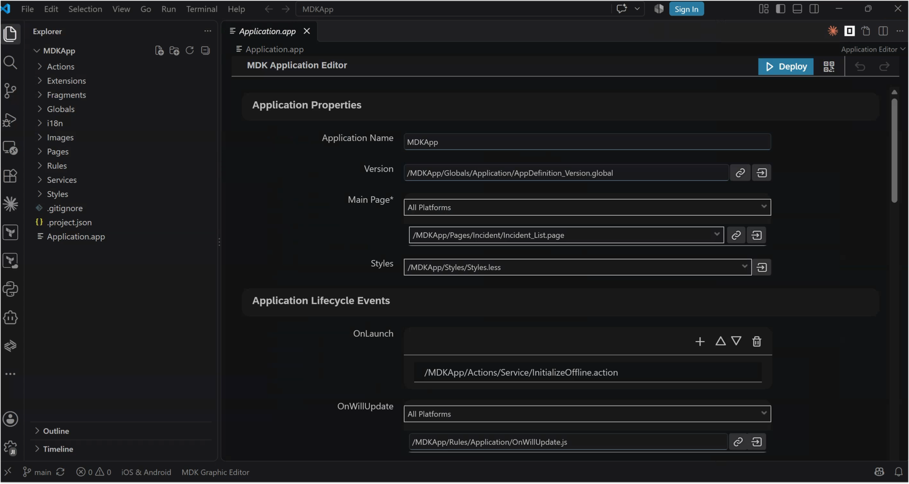


### Exercise 1.2 - Provide Your Assigned Service Worker ID to Filter Related Incidents

1. In the VS Code Explorer, expand `Pages` &rarr; `Incident`, and click on the `Incident_List.page` to open it with the **Page Editor**.

    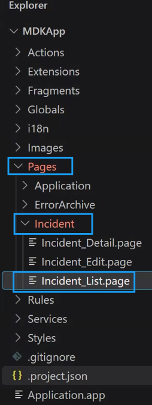

2. Select the Object Table. In the **Target** section, locate the **QueryOptions** field. Its existing value ends with `workerID`; replace only `workerID` with the Service Worker ID assigned to you, leaving the rest of the query unchanged.

    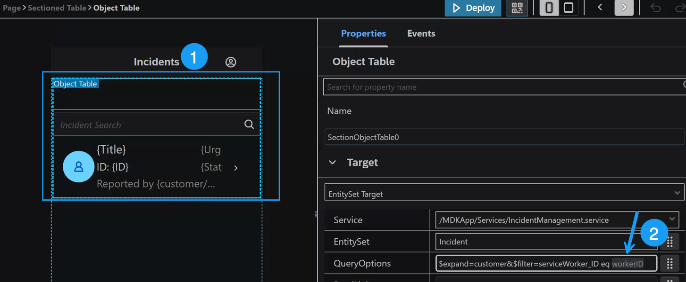

3. Save your changes manually. (**File** &rarr; **Save** or `Ctrl+S`).


### Exercise 1.3 - Deploy the Application

You will now deploy the application definitions to SAP Mobile Services. When you start the deployment, VS Code will first ask you to sign in to Cloud Foundry.

1. With a page open in the MDK Page Editor (for example `Incident_List.page` from the previous step), click the blue **Deploy** button in the Page Editor toolbar (top-right of the editor).

    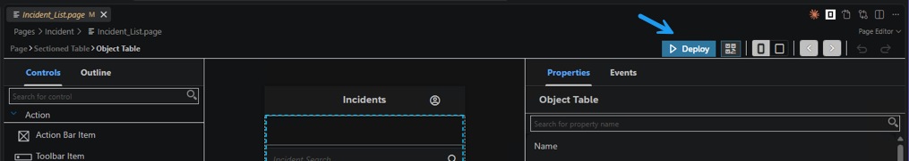

2. If you are not yet signed in to Cloud Foundry, the MDK editor extension prompts you with **Please login to Cloud Foundry first**. Click **Login** to open the **Cloud Foundry Sign In and Targets** view.

    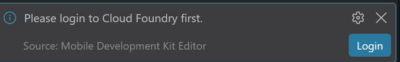

3. Enter the following as the **Cloud Foundry Endpoint** (this is the API endpoint, not the app-domain `cfapps...` URL), then select **SSO Passcode** as the authentication method and click **Open a new browser page to generate your SSO passcode**.

    ```url
    https://api.cf.eu10-005.hana.ondemand.com
    ```

    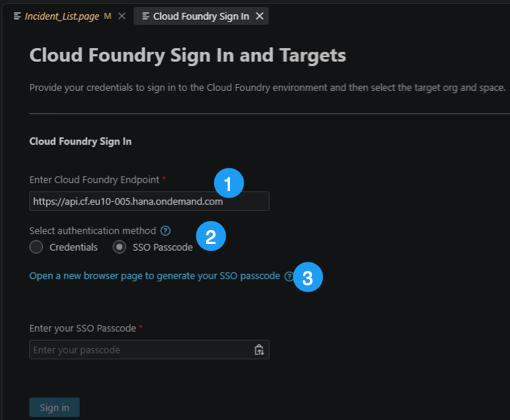

4. On the **Choose your identity provider** page, enter the following origin key for the custom IdP, then click **Sign in with alternative identity provider**.

    ```url
    tdct3ched1-platform
    ```

    >Do **not** use *Sign in with default identity provider*. The default IdP is being disabled before the event, so always use the alternative IdP with the origin key above.

    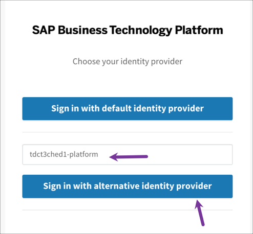

5. Sign in with the participant credentials shared with you. Copy the **Temporary Authentication Code** that is displayed.

    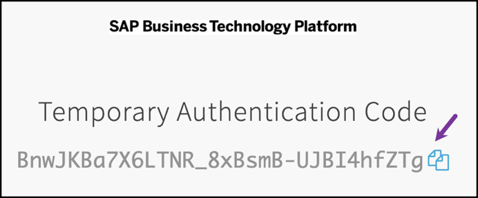

6. Switch back to VS Code, paste it into the **SSO Passcode** field, and click **Sign In**.

    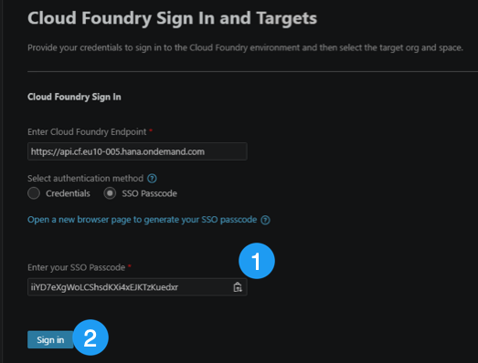

7. Once signed in, select the **Cloud Foundry Organization** and **Space**, and click **Apply**.

    | Field | Value |
    |----|----|
    | `Organization` | `ad265` |
    | `Space` | `dev` |

    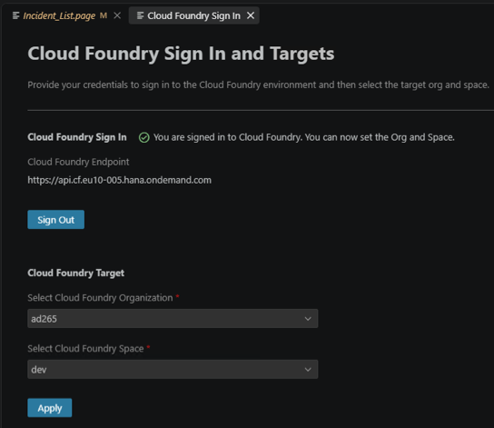

8. Continue the deployment. When prompted **Please select Mobile Services landscape**, choose **standard**.

    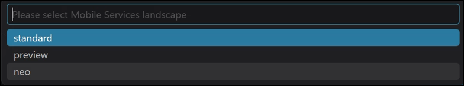

9. When prompted **Please select an application from Mobile Services**, choose the Mobile Services App ID assigned to you, `sap.mobile.ad265.XXX` (replace `XXX` with your student number, e.g. `sap.mobile.ad265.001`).

    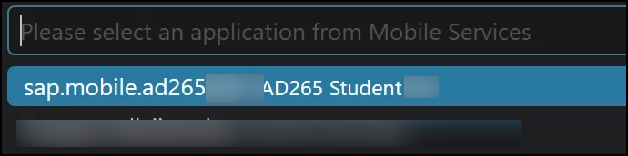

10. The MDK Bundler builds the upload bundle and deploys it to Mobile Services. The build runs in the terminal; when it finishes, you should see a **Deployed to Mobile Services successfully!** message.

    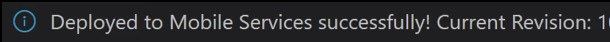

### Exercise 1.4 - Display the QR Code for Onboarding the Mobile App

You will now run the initial application on the Mobile client installed on your device by scanning the onboarding QR code. 

1. With a page open in the MDK Page Editor, click the **QR code** icon in the Page Editor toolbar (next to the **Deploy** button, top-right of the editor).

    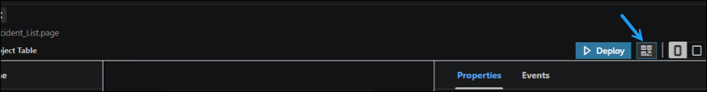

2. The Onboarding QR code is now displayed. Leave the Onboarding dialog box open as you proceed to the next step.

    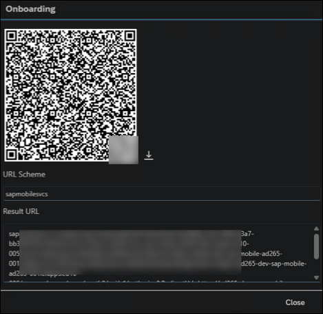

### Exercise 1.5 - Run the App

| Steps | Android | iOS |
| --- | --- | --- |
| 1. Launch **`Mobile Svcs`** app on your mobile device. Tap **Agree** on **End User License Agreement and Privacy Statement** screen. | 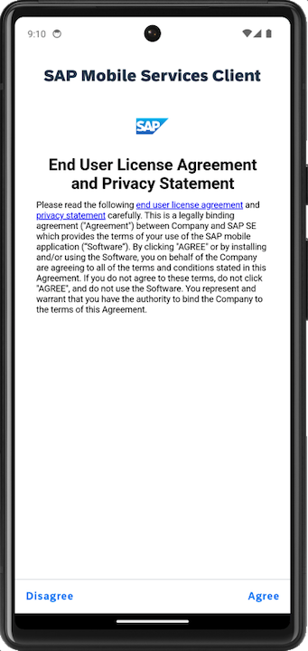 | 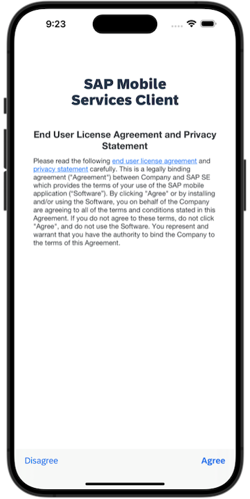 |
| 2. Tap **Scan** to start the device camera for scanning the onboarding QR code and grant permission to access the camera. Please note, if you already have the MDK client onboarded, tap *Get Started* and *Scan new QR code* to continue. | 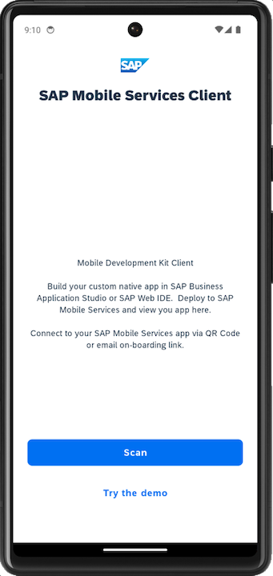 | 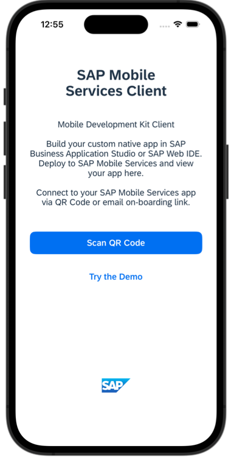 |
| 3. Once the scan succeeds, tap **Continue**. | 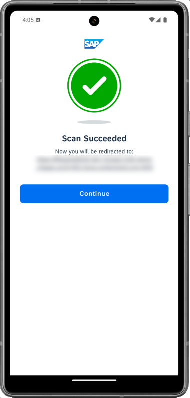 | 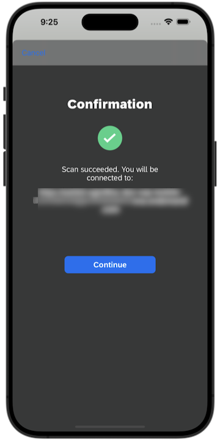 |
| 4. Tap `tdct3ched1.accounts.ondemand.com` to sign in. Use the login credentials that were shared with you during the session to log into SAP BTP. | 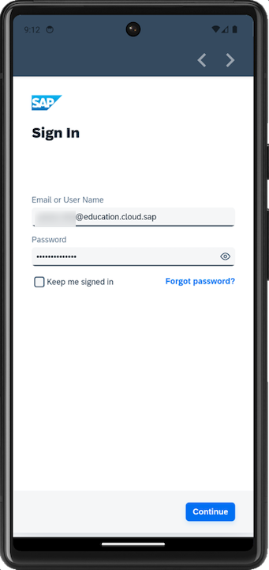 | 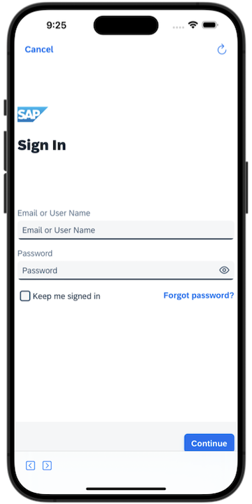 |
| 5. **(Android only)** Tap **Next**. If you want your MDK client to send you notifications, tap **Allow**, otherwise, tap **Don't allow**. | 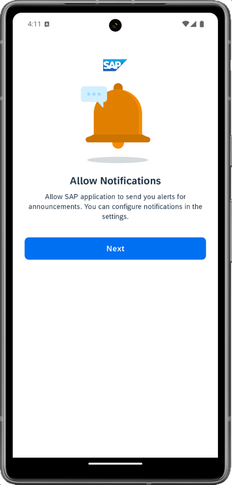 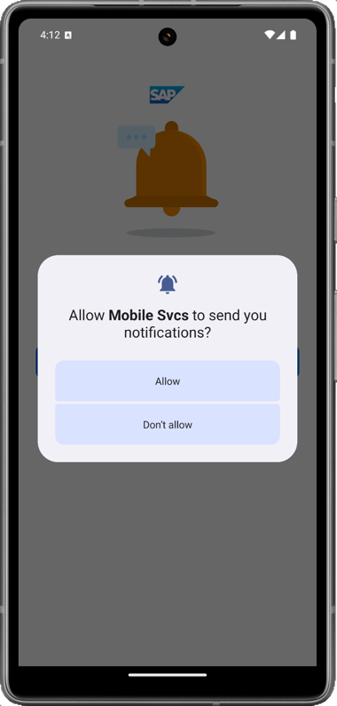 | NA |
| 6. Tap **Now** to accept the deployed metadata definitions. | 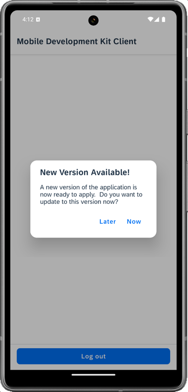 | 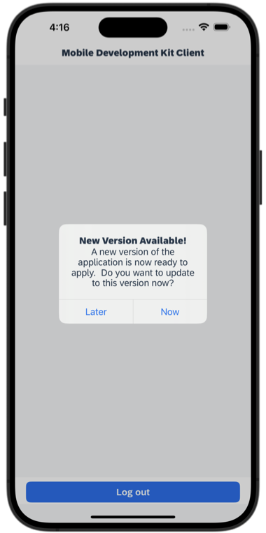 |
| 7. After accepting the app update, the offline store will initialize. You'll see a list of incidents assigned to you and a user menu icon on the main page. The user menu includes the following items:<br/><br/>- **Sync Changes:** This allows you to upload any local changes from the Mobile client to the backend and download any delta changes from the backend to the Mobile client.<br/><br/>- **Support:** This provides an easy way for users to contact support via a contact cell. The contact information is defined in the global settings.<br/><br/>- **Activity Log** option on the Support page allows the user to toggle client logging on or off, set the log level, set tracing categories, toggle OData tracing and, if enabled in the Mobile Services application, upload the current client logs. <br/><br/>- **Check for Updates:** This checks if new metadata has been deployed to the Mobile Services App Update. If new metadata is found, it will be downloaded and the user will be prompted to apply the changes.<br/><br/>- **About:** This page displays the current user/device ID, Application Name, Metadata version, and Client Version information.<br/><br/>- **Logout:** This completely resets the client, erasing any downloaded data and application metadata, and returns the user to the license agreement screen. | 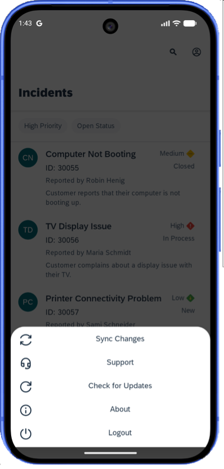 | 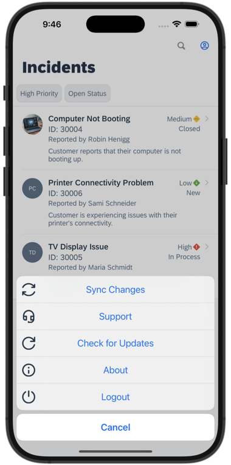 |
| 8. Tap any of the incidents to navigate to the detail page, where you'll find more information about the incident. You can also access the customer's address via a maps application. If the incident is marked as `closed`, an option to view the image of the defective device will be available. | 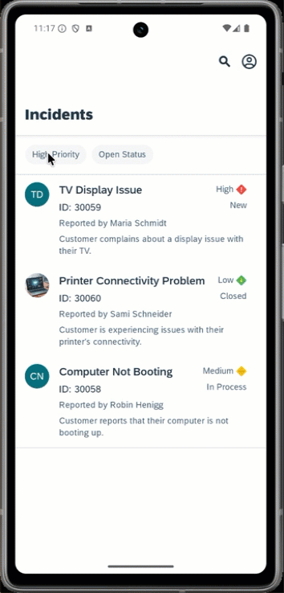 | 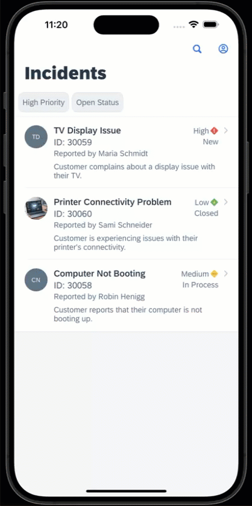 |

## Summary

You now have the starting application running in your MDK client.

## Navigation

|  Next |
|---|
| [Exercise 2](../ex2/README.md) |
